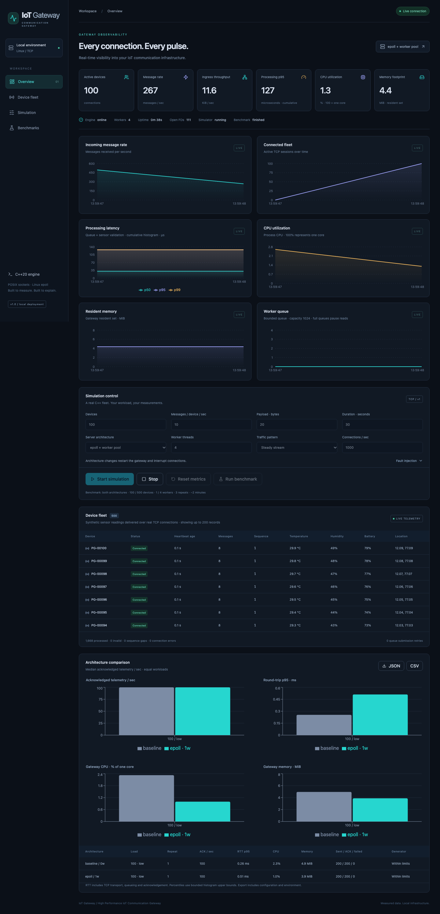
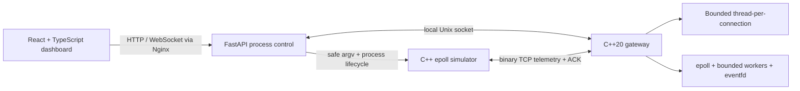
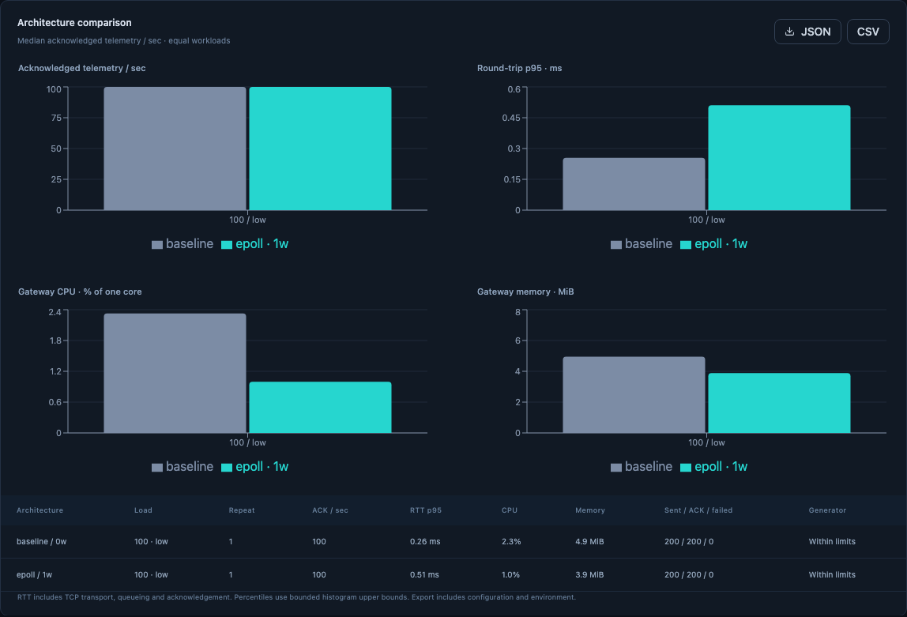

# IoT Gateway · High Performance IoT Communication Gateway

A working C++20/Linux systems project: real binary TCP telemetry, interchangeable thread-per-connection and epoll architectures, a scalable C++ fleet simulator, and a live React observability dashboard. FastAPI controls processes and forwards Unix-socket metrics; all performance-critical networking stays in C++.



## Start locally

Install Docker with Compose, then from this directory:

```bash
docker compose up --build
```

Open **http://localhost:3000**. Click **Start simulation** to send synthetic temperature, humidity, battery and location data over actual TCP. Select a server architecture before starting; switching modes restarts the listener and interrupts connections. Stop the workload before configuring or resetting metrics. **Run benchmark** collects repeated measurements for both architectures and epoll worker counts; export JSON/CSV before restarting the backend.

If port 3000 is already occupied:

```bash
FRONTEND_PORT=3001 PUBLIC_ORIGIN=http://localhost:3001 docker compose up --build
```

Stop with `docker compose down`. The only named volume shares the IPC socket; measurements are intentionally in memory. No cloud accounts, database, paid APIs or hardware are needed. ARM64 and AMD64 builds use native multi-architecture base images. Apple Silicon runs the same Linux epoll code inside Docker Desktop's Linux VM; benchmark numbers differ from native Linux.

## Architecture



- **Core:** C++20, POSIX sockets, Linux epoll/eventfd, RAII, threads/atomics, CMake, GoogleTest.
- **Simulator:** one event-driven process, configurable rate/ramp/payload/duration, heartbeats, ACK tracking, bounded queues, reconnection and fault injection.
- **Control:** Python 3.12, FastAPI/Pydantic, exclusive simulation/benchmark orchestration, bounded stdout/stderr, timeout-limited Unix IPC.
- **Dashboard:** React/TypeScript/Vite, Tailwind, shadcn-style Radix Button, Recharts and Lucide; 1 Hz real snapshots, capped history and fleet table, four measured benchmark plots.
- **Deployment:** multi-stage Docker builds, health checks, localhost-only published ports, unprivileged application users, CPU/memory limits, GitHub Actions.

## What is measured

Connectivity, cumulative message/byte/processing counters, interval throughput, CPU/RSS/FD/thread counts, queue depth/capacity, invalid input, full-queue retries, sequence gaps and reconnects come from C++. Gateway processing latency and independent simulator telemetry ACK RTT are distinct measurements. Neither component estimates one-way network latency using clocks from different processes. Latency percentiles use bounded log2 histograms and represent bucket upper bounds.

The baseline and optimized server use the same protocol, payload validation, session rules and admission cap. epoll does not automatically beat threads: small fleets and cheap validation can favor the baseline. See [actual results](docs/results.md) and [methodology](docs/benchmarking.md) for configuration, error counts and interpretation. No fabricated results initialize the dashboard.

## Build and test

On native Linux (Debian/Ubuntu):

```bash
sudo apt-get update
sudo apt-get install -y g++ cmake make libgtest-dev python3-venv
cmake -S . -B build -DCMAKE_BUILD_TYPE=Release
cmake --build build -j4
ctest --test-dir build --output-on-failure
python3 scripts/integration.py
```

The integration script starts and stops its own gateway and requires TCP port 9000 to be free. For all C++ and API tests in an isolated Linux container:

```bash
docker build -f Dockerfile.test -t iot-gateway-test .
docker run --rm iot-gateway-test python3 scripts/integration.py
docker run --rm iot-gateway-test python3 scripts/test_backend.py
```

Sanitizers:

```bash
docker run --rm iot-gateway-test sh -c 'cmake -S . -B build-asan -DENABLE_SANITIZERS=ON -DCMAKE_BUILD_TYPE=Debug && cmake --build build-asan -j4 && ctest --test-dir build-asan --output-on-failure && GATEWAY_BIN=/src/build-asan/gateway/pulse_gateway SIMULATOR_BIN=/src/build-asan/simulator/pulse_simulator python3 scripts/integration.py'
```

Dashboard build and browser tests against running Compose:

```bash
cd frontend
npm ci
npm run build
npx playwright install chromium
npx playwright test
# Alternate port: PULSE_URL=http://localhost:3001 npx playwright test
```

For a local Linux development session, start `build/gateway/pulse_gateway --ipc /tmp/pulsegate.sock`; in a second shell create a backend venv, install `backend/requirements.txt`, then run `GATEWAY_IPC=/tmp/pulsegate.sock GATEWAY_HOST=127.0.0.1 SIMULATOR_BIN="$PWD/build/simulator/pulse_simulator" PYTHONPATH=backend .venv/bin/uvicorn app.main:app --port 8000`. In `frontend`, run `npm run dev -- --port 3000` (Vite proxies API/WebSocket to port 8000). Only Linux is supported for core sockets; use containers on macOS.

## Benchmark suite

```bash
python3 benchmarks/run.py --counts 100,500,1000,5000 --workers 1,4 --scenarios low,high,burst,churn,large --duration 10 --repetitions 3
```

A full suite is deliberately longer than a UI demo. Each run includes ramp-aware warm-up, fixed duration, ACK drain, repetitions, independent simulator counts and environment capture. The output directory contains JSON and CSV. The CLI records resource-restricted results, rather than pretending a requested fleet was fully admitted.



## Engineering tradeoffs and limits

- Single I/O loop scans connections for timeouts and dispatch; worker validation is deliberately small and may not amortize handoff costs. CPU, fleet size, payload and message rate determine the bottleneck.
- Fixed limits bound every queue and registry. Full task queues pause reads and retry; invalid input/idle timeout/output limits close sessions. Simulator failure counts make unacknowledged telemetry visible.
- Session admission and OS thread limits can restrict the baseline before the requested device count. Simulator itself can become CPU-bound; export its metrics alongside gateway metrics.
- Dashboard device snapshots show at most 200 of 10000 stored records; connected sessions take priority in the bounded sample; there is no sorted pagination. Sensor values are synthetic. Browser history is 90 seconds; benchmark results live in memory until export.
- Histograms are coarse, CPU/RSS are sampled at 1 Hz, and short demo benchmarks are achieved workloads rather than saturation claims. Pure network latency, TLS, authentication, persistent telemetry storage and persistent per-device error history are outside v1. The local control service is intended for loopback demonstrations, not public Internet exposure.
- Optional isolated tc/netem instructions are documented, but not part of normal deployment or completed validation. The C++ AMD64 container build and unit tests passed under emulation; native AMD64 performance remains unvalidated. Full deployment validation uses Linux ARM64 containers.

## Explore the code

| Area | Location |
|---|---|
| Protocol serialization and framing | `gateway/src/protocol`, [wire contract](docs/protocol.md) |
| Servers and safe connection ownership | `gateway/src/network/server.cpp` |
| Bounded reusable pool | `gateway/include/thread_pool.hpp` |
| Metrics, histogram, device registry | `gateway/src/metrics` |
| Event-driven fleet generator | `simulator/src/simulator.cpp` |
| IPC and orchestration | `backend/app/services` |
| Dashboard | `frontend/src` |
| Benchmark driver and raw measurements | `benchmarks/`, [results](docs/results.md) |
| Architecture and interview explanations | [architecture](docs/architecture.md), [ENGINEERING.md](ENGINEERING.md) |
| Requirements and implementation evidence | [requirements](docs/requirements.md), [progress](docs/progress.md) |

## Resume suggestions

See [results.md](docs/results.md) for two concise bullets tied to actual runs. Use the recorded environment when discussing those measurements; avoid translating a local Docker result into embedded hardware claims.
