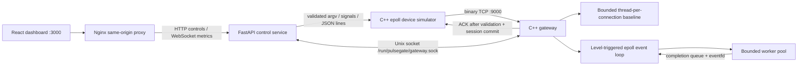

# Architecture

## Ownership and concurrency

The optimized loop exclusively owns connection descriptors, decoders, session sequencing, decoded backlogs and outgoing buffers. Each accepted socket receives a monotonically increasing token; workers return the token instead of an FD, preventing a late completion from targeting a reused descriptor. Workers own frame copies, validate sensor data and hash payload bytes. At most one task per connection is outstanding, preserving protocol order. Completions are committed to the session registry in the event loop before ACK generation. Completion memory is bounded by admitted-session and task-queue limits; stale tokens from closed sessions are ignored.

The reusable worker pool uses a mutex/condition variable queue, fixed thread count and explicit capacity. Full queue submission returns false; the connection retains its frame, suspends reads, and retries after subsequent completions or a 50 ms epoll timeout. Rejected/overflow counters count submission retries, not dropped telemetry. No accepted frame is silently removed on queue saturation. Resource/timeout closure can still prevent ACK delivery: simulator failed and ACK counters expose that outcome.

Level triggering permits limited work per socket for fairness without needing to drain every receive to EAGAIN in one callback. Sends drain until complete or EAGAIN, registering EPOLLOUT only for pending bytes. Interest masks are changed only when they differ, avoiding epoll_ctl calls for every idle socket. Accepts are capped at 256 per event turn. EINTR is retried and asynchronous connects verify SO_ERROR.

The baseline owns one joinable thread per admitted connection, bounded by the same configured session limit. Finished threads are reaped continuously; thread creation failure closes the socket and records failed admission. Reads and writes still use nonblocking sockets with poll, allowing shutdown and idle deadlines without blocking indefinitely.

Signal/configuration shutdown stops admission and reads, drains already decoded work/ACKs for up to two seconds, joins workers and releases descriptors. Frames still in kernel receive buffers are not guaranteed an ACK; clients detect closure. Artificial ACK sleeps are skipped once shutdown begins. Architecture configuration replaces the TCP listener after the old server has joined; it cannot be switched seamlessly.

## Control and metrics

IPC accepts one newline-terminated command per local Unix connection: `status`, `metrics`, `reset`, `configure MODE WORKERS`. Commands have a 256-byte limit and one-second socket deadlines; responses are bounded by a 200-record device sample. Socket permissions 0660 and a shared UID isolate access to the two local services. TCP's raw demonstration port and the UI bind only to host loopback. The backend port is not published, uses no shell, validates every argument, rejects cross-origin browser mutations, and exclusively reserves the simulator for either an interactive run or a benchmark. The service has one Uvicorn worker because its lifecycle state is intentionally in memory.

FastAPI polls IPC once per second. It calculates rates from monotonic sample intervals and C++ cumulative counters, CPU from rusage deltas, and forwards snapshots over WebSocket. Gateway metrics have atomics for counters and a mutex for the bounded device registry and 64-bucket log2 latency histogram. Histograms report bucket upper bounds, not exact percentiles. Linux /proc reports RSS, descriptors and actual thread count. Device registry holds up to 10000 entries, evicting disconnected entries when required; browser snapshots show at most 200, prioritizing connected sessions. Browser history is capped at 90 seconds, backend sampling at 180 samples, and benchmark history at 500 rows per suite.

The frontend contains no fabricated chart series. Benchmark plots start empty and use measured runs, with medians across repetitions. CPU and memory sampling is coarse (~1 second); short runs are demonstrations, not definitive throughput studies.
